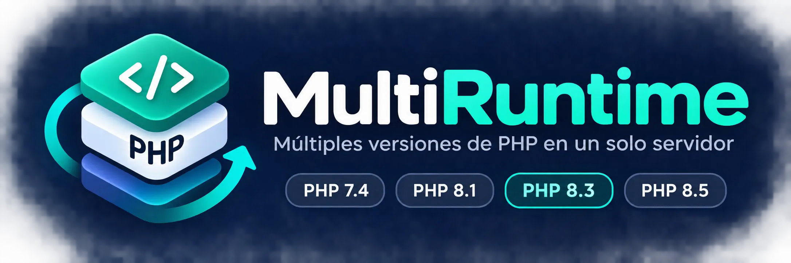

<p align="center">
  
</p>

<p align="center"><b>English</b> · <a href="README.md">Español</a></p>

# MultiRuntime (`mrt`)

A runtime version manager for Linux (and, experimentally, macOS), in the style of `nvm`, starting with **PHP**.
A single Go binary. It lets you keep your latest PHP installed system-wide while using
PHP 7.4 (or any other version) in specific projects, each with its own `composer` and its
own extensions. It does not use Docker and does not touch your system packages.

```sh
cd ~/projects/old-laravel
mrt php local 7.4        # writes .php-version
php -v                   # PHP 7.4.x
composer install         # runs with PHP 7.4

cd ~/projects/new-app
php -v                   # your system PHP (8.x)
```

## Contents

1. [What you need (requirements)](#1-what-you-need-requirements)
2. [Install mrt](#2-install-mrt)
3. [Install and configure a PHP version](#3-install-and-configure-a-php-version)
4. [Pin a project to a PHP version](#4-pin-a-project-to-a-php-version)
5. [Extensions and extra packages](#5-extensions-and-extra-packages)
6. [Keeping everything up to date](#6-keeping-everything-up-to-date)
7. [Command reference](#7-command-reference)
8. [How it works](#8-how-it-works)
9. [Status and limits](#9-status-and-limits)
10. [Project layout and development](#10-project-layout-and-development)

---

## 1. What you need (requirements)

What you need depends on **what you are going to do**. Not everyone needs a compiler.

| To… | You need | Notes |
|---|---|---|
| **Install `mrt`** | Linux (amd64 or arm64; WSL works) or [macOS (experimental)](#macos-experimental), `bash`, `git`, `curl` | No `sudo`: use your normal user. **You do not need Go**: if it is missing, a temporary copy is downloaded and removed afterwards. |
| **Install a prebuilt PHP** (8.0 and later) | Nothing besides an internet connection | Static binary: installs in seconds. Usually one or two patch releases behind php.net. |
| **Build PHP from source** (required for 7.4; recommended for the latest patch of 8.x) | `gcc`, `make`, `perl`, `pkg-config`, `tar`, `xz` | `mrt` checks before starting and tells you what is missing. CMake is not needed: it downloads its own. |
| **Add extensions** (`mrt php ext add`) | The above + `autoconf` and `m4` | Only on versions built from source. |
| **Composer** | Nothing | Downloaded automatically the first time, SHA256-verified, and run with the project's PHP. |

Install the build tools (once per server, requires `sudo`):

```sh
# Debian / Ubuntu
sudo apt install build-essential perl pkg-config xz-utils autoconf m4

# Fedora / RHEL
sudo dnf install gcc gcc-c++ make perl pkgconf-pkg-config xz autoconf m4

# Alpine
sudo apk add build-base perl pkgconf xz autoconf m4
```

### Which route should I take?

| I want… | Command | How it is obtained | Time | Needs a compiler |
|---|---|---|---|---|
| PHP 8.x quickly, even one patch behind | `mrt php install 8.3 --prebuilt` | static binary | seconds | no |
| The **latest** patch of an 8.x | `mrt php install 8.3` | built from source | minutes | yes |
| **PHP 7.4** | `mrt php install 7.4` | built from source | minutes | yes |
| Extensions that are not included | `mrt php ext add redis` | built with `phpize` | minutes | yes (+ `autoconf`, `m4`) |

`mrt php install <version>` always picks the **highest patch available** across all sources. That is why,
without `--prebuilt`, installing an 8.x may build from source if php.net has a newer patch than the static
binary; if the build tools are missing, it stops with a clear message and installs nothing.

### macOS (experimental)

`mrt` can also be installed on macOS (Intel and Apple Silicon) with the same command as in section 2, but it
**has not been tested on a Mac yet**: it has only been verified to compile for `darwin/amd64` and
`darwin/arm64`. It works like this:

| Version | How it is obtained on macOS | Requirement |
|---|---|---|
| PHP 8.0 or later | prebuilt static binary (`mrt php install 8.3`) | none |
| **PHP 7.4** | **Homebrew**: `mrt php install 7.4` runs `brew tap shivammathur/php` and `brew install shivammathur/php/php@7.4`, and registers that PHP in `mrt` | [Homebrew](https://brew.sh) installed |

- PHP 7.4 is not built from source on macOS: the Homebrew formula is used, which already builds it for Intel
  and Apple Silicon. It is installed *keg-only* (not linked into your `PATH`), so it does not clobber any
  other PHP; `mrt` only uses it in projects whose `.php-version` is `7.4`.
- `.php-version`, `mrt php local`, `composer` and the shims work exactly as on Linux.
- Extensions of that version are managed with Homebrew (for example
  `brew install shivammathur/extensions/redis@7.4`), not with `mrt php ext add`.
- There is no building from source (`--profile source`) on macOS, and `mrt php uninstall 7.4` only removes
  the `mrt` registration; to delete the Homebrew PHP use `brew uninstall`.
- If something fails, open an *issue* with the output of `mrt doctor`, your macOS version and your chip.

---

## 2. Install mrt

### Option A: one command (recommended)

It clones the repository into a temporary folder, builds `mrt`, installs it into `~/.mrt` and **removes
everything temporary** when it finishes, even if something fails.

```sh
curl -fsSL https://raw.githubusercontent.com/rasoftdev/MultiRuntime/main/get.sh | bash
```

Variants:

```sh
# also add the PATH line to ~/.bashrc and ~/.zshrc
curl -fsSL https://raw.githubusercontent.com/rasoftdev/MultiRuntime/main/get.sh | bash -s -- --write-rc

# update mrt: run the same command again (installed PHP versions are kept)

# uninstall: deletes ~/.mrt entirely (including PHP versions) and the rc lines
curl -fsSL https://raw.githubusercontent.com/rasoftdev/MultiRuntime/main/get.sh | bash -s -- uninstall
```

Optional variables: `MRT_REPO` (git URL), `MRT_REF` (branch or tag, default `main`) and `MRT_HOME`
(install folder, default `~/.mrt`). The script refuses to run as root. As with any `curl | bash`,
review it first if you do not trust the source.

> The URL assumes the repository lives at `github.com/rasoftdev/MultiRuntime` (branch `main`). If you
> publish it elsewhere, change the URL in the command or set `MRT_REPO`.

### Option B: from a cloned repository

```sh
scripts/build.sh                  # builds dist/mrt-{linux,darwin}-{amd64,arm64} (requires Go 1.22+)
scripts/install.sh --write-rc     # installs into ~/.mrt and adds the line to .bashrc/.zshrc
```

You can also install a prebuilt binary from a URL:
`MRT_URL=https://host/mrt-linux-amd64 scripts/install.sh`.

### Enable the shims in your shell

If you did not use `--write-rc`, add this line to your `~/.bashrc` or `~/.zshrc` and open a new shell:

```sh
eval "$(~/.mrt/bin/mrt env)"
```

This puts `~/.mrt/shims` **before** your system PHP in the `PATH`. With no `.php-version`, the `php` and
`composer` shims fall through to the system PHP, so nothing changes until you ask for it.

### Check the installation

```sh
mrt doctor
```

It should report `ok` for the `php` and `composer` shims and that the shims are in the `PATH`.

---

## 3. Install and configure a PHP version

Full example for a Laravel project on PHP 8.3 (the same flow works for any version):

```sh
# 1) (only if you will build from source) install the build tools — see section 1
sudo apt install build-essential perl pkg-config xz-utils autoconf m4

# 2) install the version
mrt php install 8.3 --prebuilt      # fast, static binary
#   or: mrt php install 8.3         # latest patch, built from source

# 3) point the project at that version
cd /path/to/your-project
mrt php local 8.3                   # creates .php-version

# 4) verify
php -v                              # PHP 8.3.x
mrt php current                     # version in use and where it comes from
php -m | grep -iE 'mbstring|openssl|pdo|tokenizer|xml|ctype|fileinfo|curl|zip|gd|intl'

# 5) install dependencies
composer install                    # downloads Composer the first time
php artisan --version
```

Notes:

- **Always check `php -m`.** Laravel needs at least `mbstring`, `openssl`, `pdo`, `tokenizer`, `xml`,
  `ctype` and `fileinfo`. A missing extension cannot be added to a static binary with `ext add`:
  reinstall the version built from source with `mrt php install 8.3 --profile source`
  (see [section 5](#5-extensions-and-extra-packages)).
- **PHP configuration** (`php.ini`) for each version is at `~/.mrt/php/versions/<x.y.z>/etc/php.ini`,
  with extras in `etc/conf.d/*.ini`. Each version has its own; editing one does not affect the others.
  Defaults: `memory_limit = 1G`, `date.timezone = UTC`.
- **Web server (nginx / apache with php-fpm):** the web server does not go through the shims. If your server
  already has a system php-fpm, the site keeps using it and `mrt` only changes the CLI. Versions built from
  source include `php-fpm` and `mrt` can manage it, one process per version, each with its own socket
  (`~/.mrt/php/versions/<x.y.z>/var/run/php-fpm.sock`):
  ```sh
  mrt php fpm start --php 7.4        # writes etc/php-fpm.conf and the pool, then starts
  mrt php fpm status                 # every version that ships php-fpm
  mrt php fpm nginx --php 7.4        # prints the location block with fastcgi_pass
  mrt php fpm reload|restart|stop|test
  ```
  Options: `--listen /path.sock` or `--listen 127.0.0.1:9074`. With a unix socket the web server user must be
  able to open it (mode `0660`: same group, or use `--listen` with TCP). It creates no systemd units and does
  not reload nginx/apache. Prebuilt versions do not ship php-fpm.
- **Cron, supervisor, systemd, CI:** your shell's `PATH` does not exist there. Use the full path and run from
  the project root so it finds `.php-version`:
  ```sh
  cd /var/www/my-project && ~/.mrt/shims/php artisan schedule:run
  ```
- **First build from source:** noticeably slower because it builds all the private libraries
  (OpenSSL 1.1, ICU, libxml2…). They are stored in `~/.mrt/deps/` and later versions reuse them; on WSL,
  PHP 7.4 with the libraries already built took about 4.5 minutes. If it fails, the full log is at
  `~/.mrt/cache/build/<version>/build.log`. When you run the command again, libraries that already
  finished are not rebuilt.

---

## 4. Pin a project to a PHP version

A project's version is set with a `.php-version` file in its root: plain text containing the version,
just like `nvm`/`pyenv`.

```sh
cd /path/to/my-project
mrt php install 7.4        # once per machine (if not installed yet)
mrt php local 7.4          # creates .php-version containing "7.4"
php -v                     # PHP 7.4.x
composer install           # runs with PHP 7.4
```

`mrt php local <version>` is equivalent to creating the file by hand: `echo "7.4" > .php-version`.

**Accepted formats**

| Content | Meaning |
|---|---|
| `8` | the latest installed PHP 8.x |
| `8.3` | the latest installed 8.3.x patch (recommended: follows security patches) |
| `8.3.12` | exactly that version |
| `system` | ignore mrt and use the system PHP (only by writing it into the file by hand) |

Blank lines and comments starting with `#` are allowed; only the first line with content counts.

**Rules**

- `mrt` looks for `.php-version` in the current directory and **walks up through parent directories**,
  so it works from any subfolder of the project (`app/`, `storage/`, etc.).
- If there are several, the closest wins. A monorepo can have a different `.php-version` per folder.
- If the project asks for a version that is not installed, `php` and `composer` stop with
  `Run: mrt php install <version>`; they do not silently use another one.
- With no `.php-version`, the global version (`mrt php global 8.3`) is used and, if there is none, the system PHP.
- Commit `.php-version` to the repository: the whole team and the server use the same version.

**Full priority order**

1. `MRT_PHP_VERSION` environment variable (for that command or session only)
2. Closest `.php-version`, walking up from the current directory
3. Global version (`mrt php global <version>`)
4. System PHP

```sh
MRT_PHP_VERSION=8.3 php -v           # one-off test without touching the project
mrt php current                      # which version is used here and where it comes from
mrt php which                        # path of the binary in use
```

**Changing version later:** `mrt php local 8.3` overwrites the file. Afterwards you will usually want to
resolve dependencies again (`composer install`, or `composer update` if your `composer.json` allows it).

---

## 5. Extensions and extra packages

Versions **built from source** include: `bcmath calendar ctype curl dom exif fileinfo filter ftp gd gettext
hash iconv intl json libxml mbstring mysqli mysqlnd opcache openssl pcntl pdo pdo_mysql pdo_pgsql pdo_sqlite
pgsql phar posix readline session shmop simplexml soap sockets sodium sqlite3 sysvmsg sysvsem sysvshm
tokenizer xml xmlreader xmlwriter xsl zip zlib`, plus `php-fpm`.

To add more later (with the app already installed and configured), use `mrt php ext`:

```sh
mrt php ext add redis              # PECL: picks the newest stable release compatible with your PHP
mrt php ext add xdebug@3.1.6       # or pin a specific version
mrt php ext add gmp                # bundled with PHP's source (also builds its library)
mrt php ext list                   # extensions enabled through .ini files
mrt php ext remove redis
mrt php ext add redis --php 7.4    # on another installed version, not the current directory's
```

How it works: it downloads the source (from PECL or from PHP itself), builds it with `phpize` against
**that** PHP version, installs the `.so` and leaves an enabled `.ini` in that version's `conf.d`. It does
not touch the others.

Limits:

- It only works on versions **built from source** (needs `autoconf` and `m4`, see section 1). Static
  binaries cannot load external extensions: to have an extensible version, install it with
  `mrt php install <version> --profile source`.
- If an extension needs a system library that `mrt` does not build (for example `imagick` needs
  ImageMagick), the build will fail; install that library on the system or pick another extension.

---

## 6. Keeping everything up to date

```sh
mrt php outdated            # installed lines (7.4, 8.3…) with a newer patch available
mrt php update              # installs the latest patch of every installed line
mrt php update 8.3          # only that line
mrt php update --prune      # also deletes older patches of the same line
mrt php list                # what is installed
mrt php uninstall 8.3.12    # deletes an exact version
```

With a `.php-version` like `8.3` (no patch), the project moves to the new patch as soon as it is
installed. If you pinned an exact patch (`8.3.12`) and removed it with `--prune`, that project will
error until you change it. To update `mrt` itself, run the install command again.

---

## 7. Command reference

| Command | What it does |
|---|---|
| `mrt setup` | installs the binary and the shims into `~/.mrt` |
| `mrt env` | prints the `export PATH=...` line |
| `mrt doctor` | checks the installation |
| `mrt php ls-remote [spec]` | installable versions |
| `mrt php install <spec>` | installs the latest patch matching `spec` (`8.3`, `7.4`, `8.3.12`) |
| `mrt php list` | installed versions (`*` marks the active one) |
| `mrt php local <spec>` | writes `.php-version` in the current directory |
| `mrt php global <spec\|system>` | default version |
| `mrt php current` / `which` | which version is used here and why / path of the binary |
| `mrt php outdated` | installed lines with a newer patch |
| `mrt php update [spec] [--prune]` | installs the latest patch of every installed line |
| `mrt php uninstall <x.y.z>` | deletes a version |
| `mrt php ext add\|list\|remove` | manages extensions of the active version (`--php x.y.z` for another) |

Install options:

- `--prebuilt`: accept the newest prebuilt binary even if php.net has a later patch.
- `--profile source`: force building from php.net sources.
- `--profile bulk|common|minimal`: extension set of the static binary (default `bulk`, the most complete).

Environment variables: `MRT_HOME` (default `~/.mrt`), `MRT_PHP_VERSION`.

---

## 8. How it works

- `mrt setup` copies the binary to `~/.mrt/bin/mrt` and creates the `php` and `composer` shims in
  `~/.mrt/shims/` (symlinks to `mrt`; behavior depends on the name it is invoked with).
- When you run `php` or `composer`, `mrt` resolves the version (see [section 4](#4-pin-a-project-to-a-php-version))
  and runs that binary with its own `php.ini` and `conf.d/`.
- `composer` is downloaded as a phar (SHA256-verified) to `~/.mrt/tools/composer/` and run with the
  project's PHP. For PHP older than 7.2.5 it uses the Composer 2.2 LTS line.

Layout on disk:

```
~/.mrt/
├── bin/mrt                     the binary
├── shims/{php,composer}        links to mrt (these go in your PATH)
├── php/versions/<x.y.z>/       each version: bin/, etc/php.ini, etc/conf.d/, lib/
├── php/global                  global version
├── deps/v1/                    compiled libraries, shared across versions
├── tools/                      composer.phar, cmake
└── cache/                      downloads and in-progress builds
```

### Where each PHP comes from

`mrt php install` queries all sources and picks the **highest patch**; when both offer the same version,
it prefers the prebuilt binary for speed.

1. **Static binaries** from [static-php-cli](https://dl.static-php.dev): install in seconds, no
   dependencies. They only exist from PHP 8.0 and are sometimes a few patches behind php.net. They cannot
   load external extensions.
2. **Building from php.net sources** (PHP 7.4 to 8.5): the only route for 7.4. The SHA256 published by
   php.net is verified. Libraries are built once into `~/.mrt/deps/` and shared: OpenSSL 1.1.1w,
   libxml2 2.9.14, libxslt, oniguruma, SQLite, curl, libpng, libjpeg-turbo, freetype, libzip, ICU 72,
   libsodium, ncurses, readline and libpq. This way the result does not depend on your distro's library
   versions (for example, PHP 7.4 does not work with OpenSSL 3).
3. **Homebrew** (macOS only, experimental): for PHP 7.4, through the `shivammathur/php` tap
   (see [macOS](#macos-experimental)).

---

## 9. Status and limits

Tested on Ubuntu 26.04 (WSL, amd64, GCC 15):

- Static PHP 8.1.34 + Composer 2.11.2 with `.php-version`, and back to the system PHP 8.3 outside the project.
- PHP 7.4.33 built from source with 53 modules, including `gd` (png, jpeg, freetype), `zip`, `intl`
  (ICU 72.1), `sodium`, `readline`, `pgsql`/`pdo_pgsql`, `xsl`, `soap`; HTTPS and curl with OpenSSL 1.1.1w.
- `mrt php ext add redis` (PECL) and `mrt php ext add gmp` (bundled with PHP, with its library): they
  build, get enabled and load; `ext list` works.
- Laravel 8.83 on PHP 7.4.33: `composer create-project`, `php artisan` and `composer install` from a
  `composer.lock`; `php` keeps resolving to 7.4 from subdirectories of the project.
- The full `get.sh` flow against a local repository: download, temporary Go, install, re-run as an update,
  uninstall and cleanup of temporary files.

**Not verified** (check the result before relying on it):

- Building 8.x versions from source (only 7.4 has been tested).
- `mrt php update` with something genuinely outdated (only the "all up to date" case was seen),
  `ext remove`, `mrt php fpm` (never run against a real php-fpm) and the `--prune` / `--prebuilt` flags.
- Exactly which extensions the `bulk` static binary ships (check with `php -m`).
- arm64: only that `mrt` compiles for that architecture was checked, not that it runs.
- Distros other than Ubuntu (Debian, Fedora, Alpine).
- **Everything on macOS** (static binaries and PHP 7.4 via Homebrew): nothing has been run on a Mac; it was
  only verified that `mrt` compiles for `darwin/amd64` and `darwin/arm64`. It is also unknown whether the
  macOS static binaries start without system security warnings.
- `get.sh`: the refusal to run as root and the `--write-rc` option.

A note on Composer: since 2.9, `composer require/update/create-project` blocks packages with security
advisories by default. On old projects (e.g. Laravel 8) this can prevent dependency resolution; turn it off
with `COMPOSER_NO_SECURITY_BLOCKING=1` or `config.audit.block-insecure: false` in `composer.json`.
`composer install` from an existing `composer.lock` is not affected.

Known limits:

- Linux (WSL included) and, experimentally, macOS. No native Windows support.
- On macOS PHP is not built from source: 8.0+ uses static binaries and 7.4 uses Homebrew.
- Building from source: only 7.4 to 8.5. PHP 7.3 or older is not supported.
- Static binaries do not support `ext add`; for that, install with `--profile source`.
- Build paths are baked in: if you move `MRT_HOME`, reinstall the versions.
- The checksums of the compiled libraries are pinned in the code, obtained when first downloaded (they
  match the officially published ones in the cases where that could be cross-checked); the static
  binaries have no published checksum.
- OpenSSL 1.1.1 is unsupported upstream; it is used only inside these private installations, for
  compatibility with PHP 7.4.

---

## 10. Project layout and development

```
cmd/mrt/               CLI (commands, dispatch by shim name)
internal/config/       ~/.mrt paths
internal/versions/     version parsing and comparison
internal/fetch/        downloads, SHA256, tar.gz extraction
internal/phpruntime/   providers (static, source), install, resolution,
                       Composer, extensions, update
internal/shim/         logic of the php and composer shims
scripts/               build.sh, install.sh
get.sh                 remote installer (curl | bash)
```

To add another runtime (Node, Python…), the idea is to create another package next to `phpruntime` with
its own list of providers and register its shim in `internal/shim`. The provider architecture
(`Provider`: `List` + `Install`) is designed for that.

```sh
go vet ./...
go build ./cmd/mrt
scripts/build.sh
```

---

## Open source

MultiRuntime is free and open-source software, released under the **MIT license** (see [LICENSE](LICENSE)):
you may use, copy, modify and distribute it, including in commercial projects, as long as you keep the
copyright notice.

**Contributing.** Contributions are welcome:

1. Open an *issue* with the bug or idea (include the output of `mrt doctor` and `mrt php current`, your distro and architecture).
2. For code changes, fork the repository, create a branch and open a *pull request*.
3. Before submitting: `gofmt -l .` prints nothing, `go vet ./...` is clean and `scripts/build.sh` builds for amd64 and arm64.
4. If you change behavior or commands, update **both READMEs** (`README.md` and `README.en.md`).

Especially useful: testing on other distros (Debian, Fedora, Alpine) and on arm64, building 8.x versions from
source, and automated tests (see [Status and limits](#9-status-and-limits)).

**Third-party software.** `mrt` downloads and uses software from others, each under its own license: PHP
(PHP License), Composer (MIT), OpenSSL, libxml2, curl, ICU, SQLite and the other libraries it builds, plus the
binaries from [static-php-cli](https://github.com/crazywhalecc/static-php-cli). This repository's MIT license
covers only `mrt`'s own code, not that software.

## Author and contact

Created by **Ricardo Alvarez** ([RASOFTDEV](https://github.com/rasoftdev)).

- Email: [dev@ricardoalvarez.co](mailto:dev@ricardoalvarez.co)
- Website: [me.ricardoalvarez.co](https://me.ricardoalvarez.co)

Found a bug or have an idea? Send me an email.
