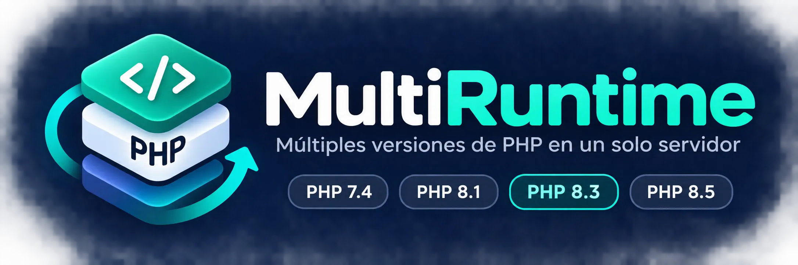

<p align="center">
  
</p>

# MultiRuntime (`mrt`)

Gestor de versiones de runtimes para Linux, al estilo `nvm`, empezando por **PHP**.
Un solo binario en Go. Te permite tener tu PHP más reciente en el sistema y, a la vez,
usar PHP 7.4 (u otra versión) en proyectos concretos, con su propio `composer` y sus
propias extensiones. No usa Docker ni toca los paquetes del sistema.

```
cd ~/proyectos/laravel-viejo
mrt php local 7.4        # escribe .php-version
php -v                   # PHP 7.4.x
composer install         # corre con PHP 7.4

cd ~/proyectos/nuevo
php -v                   # tu PHP del sistema (8.x)
```

## Cómo funciona

- `mrt setup` copia el binario a `~/.mrt/bin/mrt` y crea los atajos `php` y `composer`
  en `~/.mrt/shims/` (enlaces simbólicos a `mrt`; el comportamiento depende del nombre
  con el que se invoca).
- Al ejecutar `php` o `composer`, `mrt` elige la versión en este orden:
  1. variable de entorno `MRT_PHP_VERSION`
  2. archivo `.php-version` del directorio actual o de un directorio padre
  3. versión global (`mrt php global`)
  4. el **PHP del sistema** (el primero en el `PATH` fuera de los shims)
- `.php-version` acepta `7`, `7.4` o `7.4.33`. Con `7.4` se usa el parche más nuevo instalado.
- Cada versión vive en `~/.mrt/php/versions/<x.y.z>/` con su propio `php.ini` y `conf.d/`.
- `composer` se descarga como phar (con verificación SHA256) a `~/.mrt/tools/composer/`
  y se ejecuta con el PHP del proyecto. Para PHP anterior a 7.2.5 usa la línea Composer 2.2 LTS.

## Instalación

Requisitos: Linux (amd64 o arm64); WSL funciona. No necesita `sudo`: todo va a tu home (`~/.mrt`).

### Opción A: un solo comando (descarga, instala y limpia)

`get.sh` clona el repositorio en una carpeta temporal, compila `mrt` (con el Go del sistema si es
1.22 o superior; si no, descarga un Go temporal), lo instala en `~/.mrt` y **borra todo lo temporal**
al terminar, incluso si algo falla.

```sh
curl -fsSL https://raw.githubusercontent.com/rasoftdev/MultiRuntime/main/get.sh | bash

# además añade la línea del PATH a ~/.bashrc y ~/.zshrc:
curl -fsSL https://raw.githubusercontent.com/rasoftdev/MultiRuntime/main/get.sh | bash -s -- --write-rc

# actualizar: volver a ejecutar el mismo comando (conserva las versiones de PHP instaladas)
# desinstalar (borra ~/.mrt entero, incluidas las versiones de PHP, y las líneas del rc):
curl -fsSL https://raw.githubusercontent.com/rasoftdev/MultiRuntime/main/get.sh | bash -s -- uninstall
```

Requiere `git` y `curl`. Variables opcionales: `MRT_REPO` (URL git), `MRT_REF` (rama o tag, por defecto
`main`) y `MRT_HOME`. Se niega a correr como root (usa tu usuario, sin `sudo`). Como con cualquier
`curl | bash`, revisa el script antes si no confías en el origen.

> La URL asume que el repositorio vive en `github.com/rasoftdev/MultiRuntime` (rama `main`). Si usas
> otra ubicación, cambia la URL del comando o define `MRT_REPO`.

### Opción B: desde el repositorio clonado

```sh
scripts/build.sh                  # compila dist/mrt-linux-amd64 y dist/mrt-linux-arm64
scripts/install.sh --write-rc     # instala en ~/.mrt y añade la línea al .bashrc/.zshrc
```

Sin `--write-rc`, añade tú esto a tu `~/.bashrc` o `~/.zshrc`:

```sh
eval "$(mrt env)"
```

También puedes instalar desde una URL: `MRT_URL=https://host/mrt-linux-amd64 scripts/install.sh`.
Compilar `mrt` requiere Go (probado con 1.27).

Comprobar la instalación: `mrt doctor`.

## Apuntar un proyecto a una versión de PHP

La versión de un proyecto se define con un archivo `.php-version` en su raíz. Es un texto plano con la
versión, igual que en `nvm`/`pyenv`.

```sh
cd /ruta/a/mi-proyecto
mrt php install 7.4        # una sola vez por máquina (si no está instalada)
mrt php local 7.4          # crea .php-version con "7.4"
php -v                     # PHP 7.4.x
composer install           # corre con PHP 7.4
```

`mrt php local <versión>` es equivalente a crear el archivo a mano:

```sh
echo "7.4" > .php-version
```

**Formatos aceptados**

| Contenido | Significa |
|---|---|
| `8` | el último PHP 8.x instalado |
| `8.3` | el último parche 8.3.x instalado (recomendado: sigue los parches de seguridad) |
| `8.3.12` | exactamente esa versión |
| `system` | ignorar mrt y usar el PHP del sistema |

Se permiten líneas vacías y comentarios que empiecen por `#`; solo cuenta la primera línea con contenido.

**Reglas**

- `mrt` busca `.php-version` en el directorio actual y **sube por los directorios padre**, así que
  funciona desde cualquier subcarpeta del proyecto (`app/`, `storage/`, etc.).
- Si hay varios, gana el más cercano. Un monorepo puede tener un `.php-version` distinto por carpeta.
- Si el proyecto pide una versión que no está instalada, `php` y `composer` se detienen con el mensaje
  `Run: mrt php install <versión>`; no usan otra por su cuenta.
- Sin `.php-version` se usa la versión global (`mrt php global 8.3`) y, si no hay ninguna, el PHP del sistema.
- Commitea `.php-version` al repositorio: todo el equipo y el servidor usan la misma versión.

**Orden de prioridad completo**

1. Variable `MRT_PHP_VERSION` (solo para ese comando o sesión)
2. `.php-version` más cercano, subiendo desde el directorio actual
3. Versión global (`mrt php global <versión>`)
4. PHP del sistema

```sh
MRT_PHP_VERSION=8.3 php -v           # prueba puntual sin tocar el proyecto
mrt php current                      # qué versión se usa aquí y de dónde viene
mrt php which                        # ruta del binario en uso
```

**Fuera de la terminal interactiva** (cron, supervisor, systemd, CI), el `PATH` de tu shell no existe.
Llama al atajo con su ruta completa desde la raíz del proyecto, para que encuentre el `.php-version`:

```sh
cd /var/www/mi-proyecto && ~/.mrt/shims/php artisan schedule:run
```

**Cambiar de versión más adelante:** `mrt php local 8.3` sobrescribe el archivo. Después de cambiar de
rama de PHP conviene volver a resolver dependencias (`composer install`, o `composer update` si tu
`composer.json` lo permite).

## Comandos

| Comando | Qué hace |
|---|---|
| `mrt setup` | instala el binario y los atajos en `~/.mrt` |
| `mrt env` | imprime la línea `export PATH=...` |
| `mrt doctor` | comprueba la instalación |
| `mrt php ls-remote [spec]` | versiones instalables |
| `mrt php install <spec>` | instala el último parche que cumpla `spec` (`8.3`, `7.4`, `8.3.12`) |
| `mrt php list` | versiones instaladas (`*` marca la activa) |
| `mrt php local <spec>` | escribe `.php-version` en el directorio actual |
| `mrt php global <spec\|system>` | versión por defecto |
| `mrt php current` / `which` | qué versión se usa aquí y por qué / ruta del binario |
| `mrt php outdated` | líneas instaladas que tienen un parche más nuevo |
| `mrt php update [spec] [--prune]` | instala el último parche de cada línea instalada; `--prune` borra los parches viejos |
| `mrt php uninstall <x.y.z>` | borra una versión |
| `mrt php ext add <nombre>[@versión]` | compila y activa una extensión (PECL o incluida en PHP) |
| `mrt php ext list` / `ext remove <nombre>` | gestiona extensiones de la versión activa (`--php x.y.z` para otra) |

Opciones de instalación:

- `--profile source`: fuerza compilar desde las fuentes de php.net.
- `--prebuilt`: acepta el binario precompilado más nuevo aunque php.net tenga un parche posterior.
- `--profile bulk|common|minimal`: conjunto de extensiones del binario estático.

Variables: `MRT_HOME` (por defecto `~/.mrt`), `MRT_PHP_VERSION`.

## De dónde sale cada PHP

`mrt php install` consulta todas las fuentes y elige el **parche más alto**; si dos fuentes
ofrecen la misma versión, prefiere el binario precompilado por rapidez.

1. **Binarios estáticos** de [static-php-cli](https://dl.static-php.dev): instalación en segundos,
   sin dependencias. Solo existen desde PHP 8.0 y a veces van unos parches por detrás de php.net.
   No pueden cargar extensiones externas (`.so`).
2. **Compilación desde las fuentes de php.net** (PHP 7.4 a 8.5): es la única vía para 7.4.
   Se verifica el SHA256 publicado por php.net. Las librerías se compilan una vez en
   `~/.mrt/deps/` y se comparten entre versiones: OpenSSL 1.1.1w, libxml2 2.9.14, libxslt,
   oniguruma, SQLite, curl, libpng, libjpeg-turbo, freetype, libzip, ICU 72, libsodium,
   ncurses, readline y libpq. Así el resultado no depende de las versiones de librerías de tu
   distro (por ejemplo, PHP 7.4 no funciona con OpenSSL 3). La primera compilación tarda
   bastante más que las siguientes.

Extensiones de las versiones compiladas: `bcmath calendar ctype curl dom exif fileinfo filter
ftp gd gettext hash iconv intl json libxml mbstring mysqli mysqlnd opcache openssl pcntl pdo
pdo_mysql pdo_pgsql pdo_sqlite pgsql phar posix readline session shmop simplexml soap sockets
sodium sqlite3 sysvmsg sysvsem sysvshm tokenizer xml xmlreader xmlwriter xsl zip zlib`, más
`php-fpm`. Se pueden añadir más con `mrt php ext add` (por ejemplo `redis`, `xdebug`, `gmp`, `bz2`).
Para PECL se elige el último release estable compatible con tu versión de PHP.

### Herramientas necesarias para compilar

`gcc`, `make`, `perl`, `pkg-config`, `tar`, `xz`; y `autoconf` y `m4` para `ext add`.
`mrt` lo comprueba antes de empezar y muestra el comando de instalación.

```sh
# Debian/Ubuntu
sudo apt install build-essential perl pkg-config xz-utils autoconf m4
# Fedora/RHEL
sudo dnf install gcc gcc-c++ make perl pkgconf-pkg-config xz autoconf m4
```

CMake, que necesitan unas pocas librerías, se descarga en una versión fija y no hace falta instalarlo.

## Estado y límites

Probado en Ubuntu 26.04 (WSL, amd64, GCC 15):

- Binario estático PHP 8.1.34 + Composer 2.11.2 con `.php-version`, y vuelta al PHP 8.3 del sistema fuera del proyecto.
- PHP 7.4.33 compilado desde fuente en ~4,5 min (con las librerías ya compiladas; la primera vez, que las
  compila todas, tarda bastante más). Con 53 módulos, entre ellos `gd` (png, jpeg, freetype), `zip`, `intl`
  (ICU 72.1), `sodium`, `readline`, `pgsql`/`pdo_pgsql`, `xsl`, `soap`; HTTPS y curl con OpenSSL 1.1.1w.
- `mrt php ext add redis` (PECL) y `mrt php ext add gmp` (incluida en PHP, con su librería): compilan, se
  activan y cargan; `ext list` funciona.
- Laravel 8.83 sobre PHP 7.4.33: `composer create-project`, `php artisan` y `composer install` desde un
  `composer.lock`; `php` sigue resolviendo 7.4 desde subdirectorios del proyecto.
- `get.sh` completo contra un repositorio local: descarga, Go temporal, instalación, reejecución como
  actualización, desinstalación y limpieza de temporales.

**Sin verificar** (comprueba el resultado antes de depender de ello):

- Compilar versiones 8.x desde fuente (solo se ha probado 7.4).
- `mrt php update` con algo realmente desactualizado (solo se vio el caso "todo al día"), `ext remove`,
  `php-fpm` y los flags `--prune` / `--prebuilt`.
- arm64: solo se comprobó que `mrt` compila para esa arquitectura, no que se ejecute.
- Otras distros además de Ubuntu (Debian, Fedora, Alpine).
- `get.sh`: la negativa a correr como root y la opción `--write-rc`.

Nota sobre Composer: desde la 2.9, `composer require/update/create-project` bloquea por defecto los paquetes
con avisos de seguridad. En proyectos antiguos (p. ej. Laravel 8) puede impedir resolver dependencias; se
desactiva con `COMPOSER_NO_SECURITY_BLOCKING=1` o `config.audit.block-insecure: false` en `composer.json`.
`composer install` desde un `composer.lock` existente no se ve afectado.

Límites conocidos:

- Solo Linux (WSL incluido). No hay soporte nativo para Windows ni macOS.
- Compilación desde fuente: solo 7.4 a 8.5. PHP 7.3 o anterior no está soportado.
- Los binarios estáticos no admiten `ext add`; para eso, reinstala con `--profile source`.
- Las rutas de compilación quedan fijadas: si mueves `MRT_HOME`, reinstala las versiones.
- Los checksums de las librerías compiladas están fijados en el código, obtenidos al descargarlas por primera vez (coinciden con los publicados oficialmente en los casos que se pudo contrastar); los binarios estáticos no tienen checksum publicado.
- OpenSSL 1.1.1 está sin soporte upstream; se usa solo dentro de estas instalaciones privadas, por compatibilidad con PHP 7.4.

## Estructura del proyecto

```
cmd/mrt/               CLI (comandos, despacho por nombre de atajo)
internal/config/       rutas de ~/.mrt
internal/versions/     parseo y comparación de versiones
internal/fetch/        descargas, SHA256, extracción tar.gz
internal/phpruntime/   proveedores (static, source), instalación, resolución,
                       Composer, extensiones, update
internal/shim/         lógica de los atajos php y composer
scripts/               build.sh, install.sh
get.sh                 instalador remoto (curl | bash)
```

Para añadir otro runtime (Node, Python…) la idea es crear otro paquete junto a `phpruntime`
con su propia lista de proveedores y registrar su atajo en `internal/shim`.
La arquitectura de proveedores (`Provider`: `List` + `Install`) está pensada para eso.

## Desarrollo

```sh
go vet ./...
go build ./cmd/mrt
scripts/build.sh
```

No hay tests automáticos todavía.
